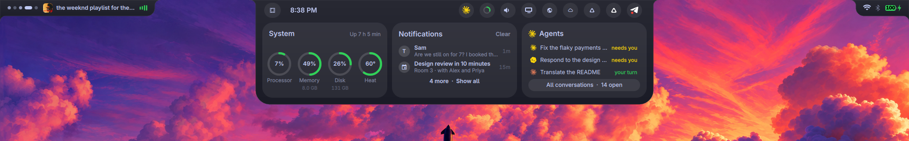
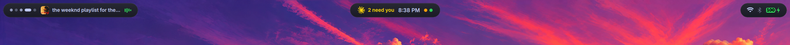
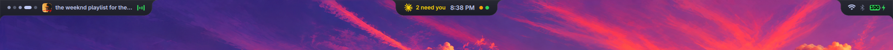
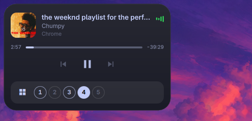
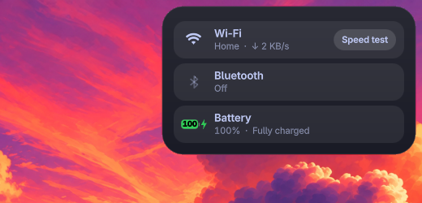
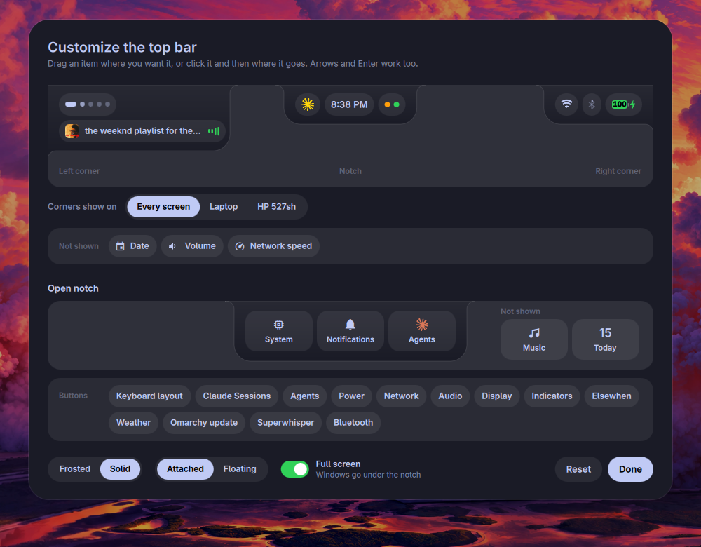

# Notch

Replaces Omarchy's top bar with a frosted notch in your theme's colours, with a corner on each side of it for your workspaces, music and status icons, and a dock to match. Made for light and dark themes alike.



Tested on Omarchy 4.5 (Hyprland 0.56, Quickshell 0.3).

## Install on Omarchy

Two commands in a terminal:

```bash
omarchy plugin add https://github.com/mikaelendale/omarchy-notch
~/.config/omarchy/plugins/mike.notch/install.sh
```

The installer:

- links `notch-look` and `claude-conversations` into `~/.local/bin`
- turns everything on

`notch-look off` puts everything back the way it was, including whichever bar you had before.

To update later: `omarchy plugin update mike.notch`, then `omarchy restart shell`.

You can also run `./install.sh` from any copy of this folder. It installs to `~/.config/omarchy/plugins/mike.notch`, or updates an earlier install where it is.

It needs a recent Omarchy (the Lua Hyprland config, and a shell that lets a plugin replace the bar) and `python3`. The installer checks for both.

**Optional: Super+Shift+C** opens a picker for your Claude Code conversations: continue one, jump to an open one, or start a new one. It needs `fzf` (`omarchy pkg add fzf`). Add this to `~/.config/hypr/bindings.lua`:

```lua
o.rebind("SUPER + SHIFT + C", "Claude conversations",
  "omarchy-launch-or-focus-tui --app-id=org.omarchy.claude-conversations claude-conversations")
```

## Screenshots

The top of the screen: workspace dots and what's playing on the left, the notch with your agents, the time and the privacy dots in the middle, Wi-Fi, Bluetooth and the battery on the right. Floating:



and attached, flaring into the top edge:



The corners, opened: the music player (with the workspaces under it), and the details of Wi-Fi, Bluetooth and the battery.

<p>
  
  
</p>

The editor (right-click the bar): what goes where, the open notch's cards and buttons, and the look.



The whole desktop:


The dock, with an app's name on hover and dots under the open ones:


A session that needs you grows the notch into a toast:


## Turning it on and off

`notch-look` switches each part on its own, and every change is undone by the opposite command:

```bash
notch-look                         # what's on now
notch-look off                     # everything back the way it was
notch-look on                      # everything on again
notch-look bar on|off              # the notch, or the bar you had before
notch-look round 14|20|off         # corner rounding for windows and pop-ups (off = square)
notch-look surfaces on|off         # frosted pop-ups, menus and notifications
notch-look claude-toasts notch|desktop   # Claude alerts in the notch, or as notifications
notch-look notifications notch|corner    # notifications under the notch, or top-right
notch-look windows under|below           # full screen under the notch, or a strip of its own
notch-look dock frosted|plain            # the dock in the notch's style, or Omarchy's own
notch-look motion on|off                 # smoother window animations and soft shadows
notch-look bell on|off                   # a terminal's bell shows its agent as needing you (foot)
notch-look font on|off                   # Omarchy's panels and menus in the notch's font
notch-look preview                       # a minute of made-up agent sessions, to see it busy
notch-look showcase                      # made-up sessions, notifications and privacy dots, no network
                                         # name, the default layout: for screenshots that show nothing of yours
notch-look edit                          # the editor (or right-click the notch or a corner)
```

It only edits marked blocks in your own config files:

- `~/.config/hypr/looknfeel.lua`
- `~/.config/omarchy/shell.toml`
- `~/.config/foot/foot.ini`
- the bar and plugin entries in `~/.config/omarchy/shell.json`
- `~/.config/fontconfig/conf.d/10-notch-look.conf` (its own file)

Nothing of Omarchy's own is touched, so updates keep coming either way. If this plugin ever fails to load, Omarchy falls back to its own bar by itself.

**Frost, in your theme's colours:** the notch and its corners, the dock, Omarchy's panels, notifications, the OSD and menus are frosted: blurred by Hyprland (Omarchy's own glass blur) under a thick tint of the current theme's colours. Omarchy's blur is light, so the tint is what keeps a busy or bright wallpaper from showing through as shapes; every theme looks like itself, whatever its wallpaper. Switching themes re-tints everything.

**Light and dark:** light themes get their own look rather than an inverted dark one:

- white cards on light glass
- soft dark edges
- status colours deepened so they read on a light surface

Status colours (working, needs you, charging, the mode switches) are fixed system colours. That way a theme can't turn "charging" grey or "needs you" blue.

**One font:** the notch is set in Adwaita Sans. Omarchy draws its own panels, menus, notifications and the dock's labels in the system's monospace font, so `notch-look font on` gives Omarchy's shell, and only it, Adwaita Sans as well. Everything around the notch then reads as one design, and your terminals keep their monospace font (Adwaita Mono, its sibling, pairs best).

**Notifications under the notch, and the frosted dock** use copies of Omarchy's notification service and dock: `~/.config/omarchy/plugins/<you>.notifications` and `<you>.dock`. Each has a few lines changed:

- notifications hang centred under the notch, below however far it reaches right now (closed, showing a toast, or open)
- the dock is restyled to match the notch (see "Dock" below), and reads your pinned apps from `shell.json`

A hook (`~/.config/omarchy/hooks/post-update.d/notch-notifications`) rebuilds both from Omarchy's latest version after every `omarchy update`, so they keep Omarchy's fixes. If an update ever changes the code so the lines no longer fit, the hook puts Omarchy's own back and tells you, rather than breaking them. `notch-look notifications corner` and `notch-look dock plain` switch back at any time.

`notch-look` only ever touches copies it made itself (marked with a `.notch-look` file). If you already have your own copy of Omarchy's dock or notifications, it's left as it is.

## Top notch

Closed, it shows your agent's mark, the time and the privacy dots, like a phone's island, with a corner on each side of it (see [Corners](#corners)):

- the mark is your agent's own: Claude's orange starburst, or Codex's, OpenCode's, Antigravity's... While a session works, a circle grows from nothing to uncover the mark and shrinks back again; when one is waiting on you, it turns yellow with **needs you**
- privacy dots, while something uses them: orange for the microphone, green for the camera, red while the screen is being recorded
- the [editor](#editor) changes what it shows: the date, music, Wi-Fi, the battery, the workspaces and more can move into it

**Every coding agent, not just Claude:**

- **Claude Code** reports exactly what it's doing.
- **Codex** is read just as exactly from its own session log (`~/.codex/sessions`): working from the moment a turn starts until it ends, needing you while it asks to run something, and done when it finished in a window you weren't looking at. A Codex that hasn't been asked anything yet is idle.
- **OpenCode, Antigravity, Crush, Amp, Cursor, Copilot, Kimi, Qwen, Gemini, Grok, Devin** and the others are found running in terminals, and show as working while they draw to the terminal or use the CPU, idle otherwise. Only what runs on the agent's own terminal counts, not background helpers.
- Any of them shows as needing you when it rings the terminal's bell (foot runs `bell.sh` for that, set up by `notch-look bell on`). That part needs foot; everything else works in any terminal.

**Toasts:** when a session starts waiting on you and you're looking at another window, the notch grows into a toast saying which session and why, with an **Open** button that takes you to it. It goes away on its own after a few seconds. To see one: `omarchy-shell mike.notch previewToast`.

**Open:** hover the notch to open the full bar:

- the Omarchy menu, the clock, and one row of round buttons: Wi-Fi, Bluetooth, volume, battery, displays, Claude, agents and the rest of Omarchy's widgets, then every tray app. The icons are the notch's own, drawn from live state. Clicking one opens Omarchy's usual panel, and only one panel is open at a time. The row never scrolls: when the right half can't hold it, the clock moves beside the menu and the buttons carry on into the left half (and the notch widens if it must). A button whose item shows in a corner (Wi-Fi, Bluetooth, the battery, the volume) leaves the row; the corner opens its panel instead, and so does its keyboard shortcut.
- cards: **System** (how busy the processor is, memory and disk in use, how warm it's running, and how long it's been up), **Notifications** (the ones you've had, newest first, even after they're gone from the screen: as many as fit, then "N more · Show all", which brings them back up as Omarchy's own cards; **Clear** starts the list afresh), **Today** (the date and this week), and your **Agents** sessions: as many as the card has room for, most urgent first, with the rest counted on the Conversations button. Music has its own corner, so its card is off by default, and so is Today; the [editor](#editor) puts it back, reorders the cards or takes any of them off. Nothing in the notch scrolls with a scroll bar; long names are cut short with "…".

**Full screen:** normally the notch keeps a strip of its own at the top, and windows start below it. The **Full screen** switch (in the editor, or `notch-look windows under`) lets every window run the whole height of the screen, under the notch. In that mode the notch is see-through while nothing's going on, and turns solid when you hover it, when a toast or notification shows, or when an agent needs you; the corners hide, and their items show in the notch instead.

**Frosted or solid:** the notch and the corners are frosted glass in your theme's colours, or, with **Solid** in the editor, the theme's colour all the way through.

**Attached, floating or unified:** the notch and the corners hang from the top edge and flare into it, or, with **Floating** in the editor, they're pills of their own a little below it, or, with **Unified**, one long bar runs across the top, a little in from either side; when the notch or a corner opens, the bar stretches out to the screen's edges and what opens grows down out of it, all one piece.

The buttons come from the same `bar.layout` in `~/.config/omarchy/shell.json` that the stock bar uses:

- the [editor](#editor), or `omarchy bar move <id> ...`, changes their order.
- `omarchy plugin disable <id>` removes one.

## Corners

Two short frosted pills tucked into the top corners of the screen, on either side of the notch. They curve into the top edge and the side edge, so they read as part of the screen's frame, like the notch.

- **Left: your workspaces and music.** The workspaces are dots, one per workspace of this screen's (Omarchy's own rule: its first five, and any other in use); the one you're on is a short bar, ones with windows are full, empty ones faint. Click a dot to go there, or scroll over them to step along. Opened, they're numbered buttons.

  The music appears when something starts playing: the cover, the title and moving bars. Paused, it stays, with the title dimmed and the bars lying flat, until the player closes. Tap it to go to the window that's playing (found by the track's title, else the media site's window, such as YouTube's). Hover it and it opens into a player: the cover and title (tap them to go to the window too), the artist and app, a seek bar you can click or drag, and the controls the player supports: shuffle, previous, play or pause, next, repeat, and its speed for players that have more than one (podcasts, videos). Shuffle and repeat show a dot while they're on. With more than one player going (Spotify and a YouTube tab, say), a small pill beside the app's name switches to the other one. Scroll over the music to skip tracks.
- **Right: Wi-Fi, Bluetooth and the battery.** Hover it and it opens into a row each: the network you're on and how fast it's going (with a **Speed test** button that runs Omarchy's speed test), the headphones that are connected, and how long the battery lasts or how long it needs to charge. Click a row and Omarchy's own panel for it opens right there, under the corner; the notch stays shut.

Scroll over a corner (anywhere but the music and the workspaces) to change the volume. When the battery drops to 15% (and again at 5%) unplugged, its corner opens for a few seconds, the battery red.

A corner with nothing to show hides. In full-screen mode, and while an app is fullscreen (Super+F), both corners hide and only the notch shows, holding their items. With more than one screen, the editor can keep the corners to one of them.

**Light on any machine:** while nothing is open, the bar's window is only as tall as the closed bar, so anything that moves repaints (and Hyprland re-blurs) a sliver of the screen rather than a big window. Things that move on their own (the music's bars, an agent at work) step a few times a second instead of every frame. Opening and closing are short timed animations, and the notch, the corners and the unified bar are plain rounded rectangles with fixed curves where they meet an edge, so a frame only resizes rectangles, nothing is re-traced. The play position only updates while a player is open, and the editor is only built while it's open. With music playing and agents at work, that took the shell from about 29% of a CPU core at idle to 3%, and Hyprland from 26% to 4%.

**Saving battery:** unplugged (and always on a modest machine, 4 GB of memory or less or 2 processor threads or fewer), everything the bar checks on is checked less often: your agents every 3 seconds instead of every second, the machine every 5, the network every 3, the privacy dots every 6.

## Editor

Right-click the notch or a corner (or run `notch-look edit`) to change everything about the bar:

- **What the corners and the closed notch show.** It shows the top of your screen in small: drag an item between the left corner, the notch and the right corner, or onto **Not shown** to take it off. Or click an item, then click where it goes (Esc puts it down). Or use the keyboard: the arrows move a ring from item to item, Enter picks it up, the arrows then move it along (Down takes it off, Up puts it back), and Enter puts it down. The items: workspaces, music, agents, the time, the date, the privacy dots, Wi-Fi, Bluetooth, the battery, the volume and the network speed.
- **Any of the open notch's buttons, onto the closed bar.** Drag one (Omarchy's own widgets, or another plugin's, such as a 2D workspace grid) into a corner or the notch and it shows there all the time, as itself; drag it back to the buttons to put it back. The corner or notch doesn't open when the pointer is on a placed widget, so it can be used where it is. The widget keeps its own settings from the bar's layout in `shell.json`.
- **Which screens get the corners**, with more than one screen.
- **Show every running agent:** a mark for each agent at work or waiting on you (Claude, Codex, OpenCode...), with how many sessions it has, instead of just the one that matters most. Off unless you switch it on.
- **The open notch's cards:** System, Notifications, Music, Today and Agents, in any order, any of them off.
- **The open notch's buttons:** Omarchy's buttons, reordered (through `omarchy bar move`).
- **Frosted or Solid**, **Attached, Floating or Unified**, and **Full screen**.
- **Motion:** **Smooth** (quick opening and closing; the music's bars and an agent at work move), **Light** (shorter opening and closing; nothing moves on its own; an agent at work shows a small green dot), or **Off** (no motion at all). **Auto**, the default, picks Light on a machine with 4 GB of memory or less or 2 processor threads or fewer, Off when Omarchy's animations are off, and Smooth otherwise.

Changes apply as they land; **Reset** puts the defaults back. It's all saved in `~/.local/state/mike-notch/prefs.json`. What the editor does goes into the shell's log, prefixed `mike.notch editor:`.

## Dock

Omarchy's dock, restyled to match the notch: it sits flush on the screen edge with the same frosted glass, and flares into the edge the way the notch flares into the top. Everything else is Omarchy's: pinning, dragging to reorder, the right-click menu, auto-hide, and showing on floating workspaces.

- Icons are a little bigger, with room to breathe, all in full colour.
- A dot under an app means it has a window open; it stretches into a short bar under the app you're using.
- Hover an icon for its name, in a small frosted pill. Icons lift with the notch's spring.
- A hairline sets the all-apps button apart from the apps.
- With more apps than the screen edge has room for, the icons get smaller, so the dock always fits.

It works on any edge: `omarchy dock position bottom|left|right|top`. `notch-look dock plain` switches back to Omarchy's own dock.

## Files

| File | What it is |
|---|---|
| `install.sh` | Installs everything and turns it on |
| `bin/notch-look` | Turns each part on and off |
| `bin/claude-conversations` | The Super+Shift+C conversations picker |
| `Bar.qml` | The bar host: data, Omarchy's widgets, tray apps, toasts, the windows |
| `Notch.qml`, `NotchShape.qml` | The top notch |
| `Ear.qml`, `EarShape.qml`, `MiniPlayer.qml`, `DetailRow.qml` | The corners: the pill, its shape, the music player and the detail rows |
| `SystemCard.qml`, `NotificationsCard.qml` | The open notch's system and notifications cards |
| `StatusItem.qml`, `Layout.js` | Every item the bar can show, drawn small; what goes where |
| `Motion.qml`, `Flare.qml`, `UnifiedStrip.qml` | How much it moves (the one other singleton); the fixed curves where a body meets an edge; the unified bar |
| `Players.js` | Finds the window that's playing, for a tap on the music |
| `Editor.qml`, `EditorChip.qml` | The editor |
| `MediaCard.qml`, `TodayCard.qml`, `ClaudeCard.qml`, `SessionRow.qml` | The open notch's cards |
| `WidgetHost.qml`, `TrayButton.qml`, `MenuRow.qml` | Round buttons for Omarchy's widgets and tray apps; tray menus |
| `ClaudeLogo.qml`, `WifiIcon.qml`, `BluetoothIcon.qml`, `VolumeIcon.qml`, `BatteryIcon.qml`, `DisplayIcon.qml`, `UsageDial.qml` | The notch's own icons |
| `HSlider.qml` | The volume slider |
| `AgentMark.qml` | Any agent's mark, with the growing-circle "working" reveal |
| `agents.py`, `claude_sessions.py`, `bell.sh` | Every agent's sessions: Claude's and Codex's from their own session files, the rest from their terminals; the bell note |
| `Theme.qml`, `qmldir` | Colours from the current Omarchy theme, light and dark (a singleton, like Motion; qmldir lists every type) |
| `CoverArt.qml`, `EqBars.qml`, `Palette.js` | Shared pieces, fonts, the motion curve |
| `look/surfaces.toml` | The frosted surfaces `notch-look surfaces on` puts into `shell.toml` |
| `look/dock/` | The dock's glass, open-app dots, name labels and separator, copied into notch-look's copy of Omarchy's dock |
| `tests/` | Off-screen renders and pointer tests (`tests/mock` stands in for Omarchy's colours and fonts for the dock) |
| `screenshots/` | The pictures in this README |

Claude's mark comes from Omarchy's own copy of the official logo (`/usr/share/omarchy/shell/plugins/agents/assets/claude.svg`).

## Tests

```bash
tests/run.sh /tmp/notch-frames
```

This does two things:

- renders every state off screen, using made-up data, into PNGs to look through, in a dark theme and a light one (Catppuccin Latte): a crowd of agent sessions with long names, a dock on each screen edge, and the battery's number at every level
- runs the pointer tests:
  - the top notch: hover, and staying open when a panel closes under the pointer
  - the editor: moving items between the corners and the notch, by dragging and by clicking, inserting before another, taking one off and putting it back, dropping outside (nothing changes), the open notch's cards, reordering its buttons, Frosted/Solid and Full screen, Reset, Done and Esc; and that what it saves is what was moved; the keyboard
  - the corners: hover opens the player and a click on the seek bar seeks, the music corner going when nothing plays and staying while paused, hiding in full screen, staying shut while their panel is open, right-click opening the editor, the workspace dots (click and scroll), the privacy dots showing only while in use, the notifications card (what fits, Show all, Clear) and switching players

Cover art only renders on a real screen.

On a real screen, `omarchy-shell mike.notch previewToast` shows a toast, `omarchy-shell mike.notch edit` opens the editor, `omarchy-shell mike.notch netState` prints the network speed the bar sees, `omarchy-shell mike.notch cornersState` what the corners are doing, `omarchy-shell mike.notch cornerPanel wifi` opens a corner's panel as a click on its row does, `omarchy-shell mike.notch open` and `close` open and shut the notch, `workspacesState`, `privacyState` and `notificationsState` print what those see, and `previewLowBattery` shows the low-battery warning. `python3 agents.py --once` prints every agent session it finds, and `omarchy-shell mike.notch fontCheck` prints the font Omarchy's shell is drawing in.

When scripting hovers with `hyprctl dispatch 'hl.dsp.cursor.move(...)'`, move straight onto the target from outside its surface. Hyprland only reports a warp to a surface the pointer is entering, so stepping across one in several warps stalls where it came in. Omarchy focuses whatever window is under the pointer, so don't move it while someone is typing.
