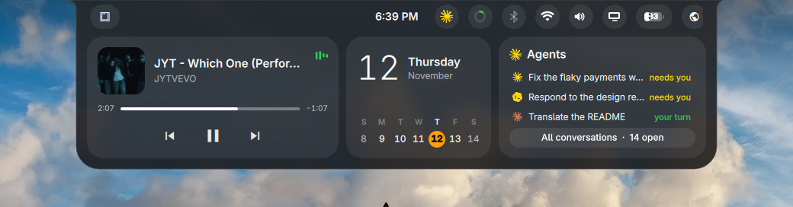
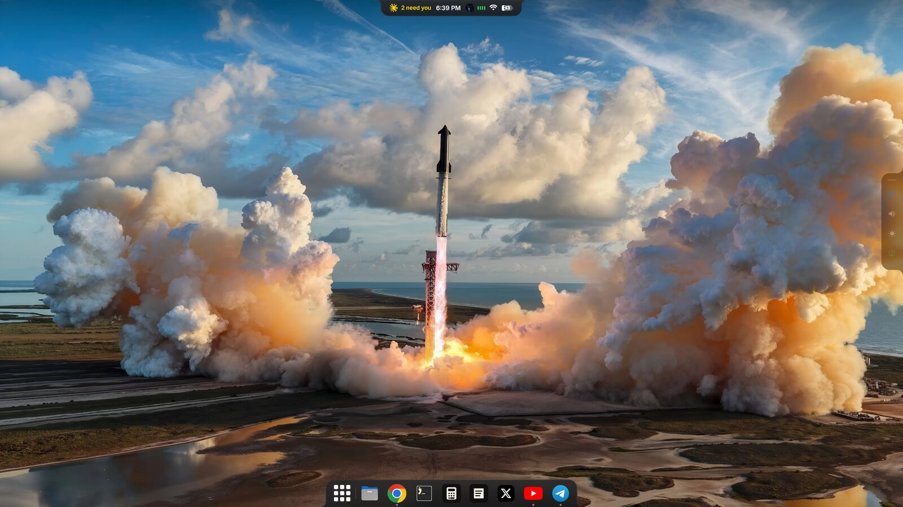
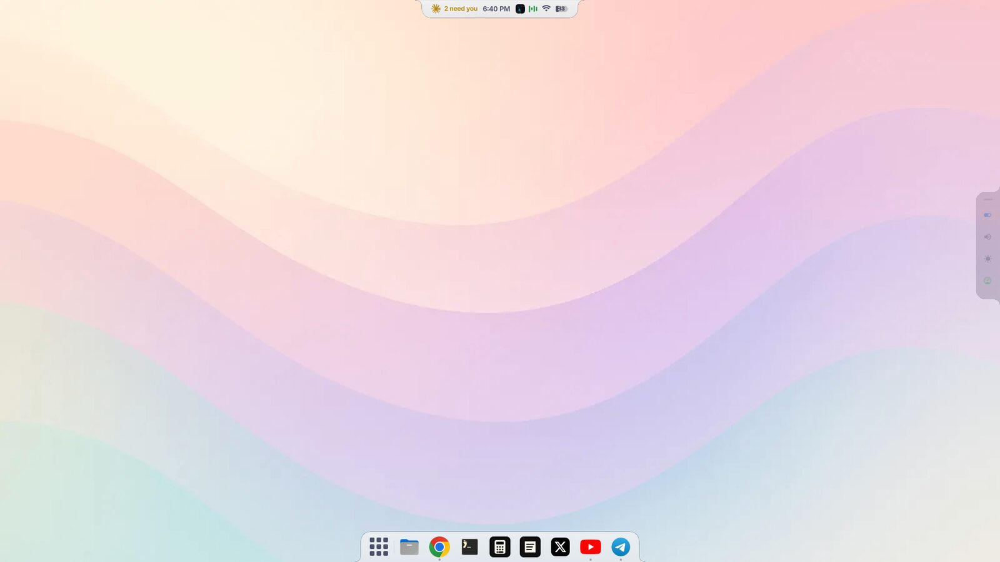
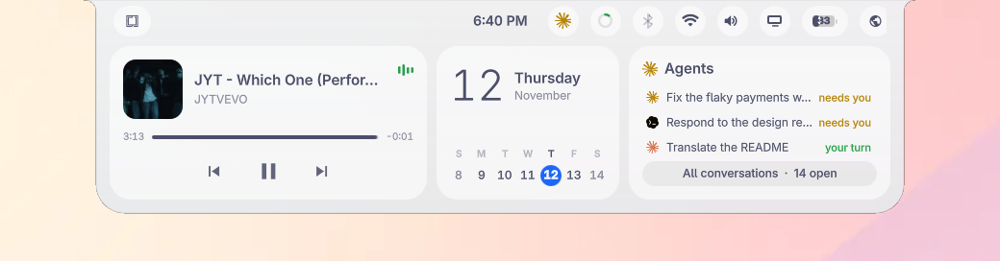
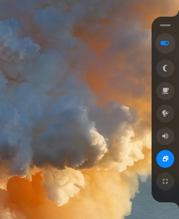
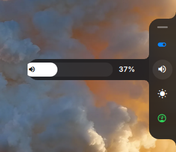
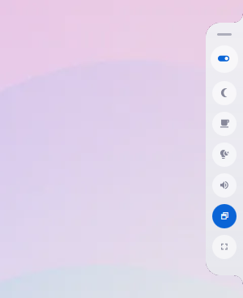
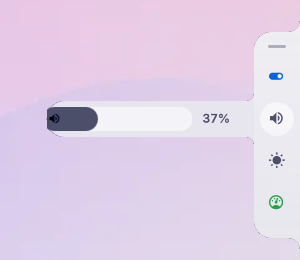

# Notch

Replaces Omarchy's top bar with a frosted notch in your theme's colours, and adds a slim strip of quick controls to the edge of the screen and a dock to match. Made for light and dark themes alike.



Tested on Omarchy 4.5 (Hyprland 0.56, Quickshell 0.3).

## Install on Omarchy

Two commands in a terminal:

```bash
omarchy plugin add https://github.com/mikaelendale/omarchy-notch
~/.config/omarchy/plugins/mike.notch/install.sh
```

The installer:

- links `notch-look` and `claude-conversations` into `~/.local/bin`
- turns everything on

`notch-look off` puts everything back the way it was, including whichever bar you had before.

To update later: `omarchy plugin update mike.notch`, then `omarchy restart shell`.

You can also run `./install.sh` from any copy of this folder. It installs to `~/.config/omarchy/plugins/mike.notch`, or updates an earlier install where it is.

It needs a recent Omarchy (the Lua Hyprland config, and a shell that lets a plugin replace the bar) and `python3`. The installer checks for both.

**Optional: Super+Shift+C** opens a picker for your Claude Code conversations: continue one, jump to an open one, or start a new one. It needs `fzf` (`omarchy pkg add fzf`). Add this to `~/.config/hypr/bindings.lua`:

```lua
o.rebind("SUPER + SHIFT + C", "Claude conversations",
  "omarchy-launch-or-focus-tui --app-id=org.omarchy.claude-conversations claude-conversations")
```

## Screenshots

The whole desktop, dark (Starship) and light (Catppuccin Latte): the notch at the top, the strip resting on the right edge, the dock at the bottom.

<p>
  
  
</p>

The notch opened, in a light theme:



The side strip: Modes dropped down, and the volume sliding out.

<p>
  
  
  
  
</p>

The dock, with an app's name on hover and dots under the open ones:


A session that needs you grows the notch into a toast:


## Turning it on and off

`notch-look` switches each part on its own, and every change is undone by the opposite command:

```bash
notch-look                         # what's on now
notch-look off                     # everything back the way it was
notch-look on                      # everything on again
notch-look bar on|off              # the notch, or the bar you had before
notch-look side on|off             # the side strip of icons
notch-look round 14|20|off         # corner rounding for windows and pop-ups (off = square)
notch-look surfaces on|off         # frosted pop-ups, menus and notifications
notch-look claude-toasts notch|desktop   # Claude alerts in the notch, or as notifications
notch-look notifications notch|corner    # notifications under the notch, or top-right
notch-look windows under|below           # full screen under the notch, or a strip of its own
notch-look dock frosted|plain            # the dock in the notch's style, or Omarchy's own
notch-look motion on|off                 # smoother window animations and soft shadows
notch-look bell on|off                   # a terminal's bell shows its agent as needing you (foot)
notch-look font on|off                   # Omarchy's panels and menus in the notch's font
notch-look preview                       # a minute of made-up agent sessions, to see it busy
```

It only edits marked blocks in your own config files:

- `~/.config/hypr/looknfeel.lua`
- `~/.config/omarchy/shell.toml`
- `~/.config/foot/foot.ini`
- the bar and plugin entries in `~/.config/omarchy/shell.json`
- `~/.config/fontconfig/conf.d/10-notch-look.conf` (its own file)

Nothing of Omarchy's own is touched, so updates keep coming either way. If this plugin ever fails to load, Omarchy falls back to its own bar by itself.

**Frost, in your theme's colours:** the notch, the side strip, the dock, Omarchy's panels, notifications, the OSD and menus are frosted: blurred by Hyprland (Omarchy's own glass blur) under a thick tint of the current theme's colours. Omarchy's blur is light, so the tint is what keeps a busy or bright wallpaper from showing through as shapes; every theme looks like itself, whatever its wallpaper. Switching themes re-tints everything.

**Light and dark:** light themes get their own look rather than an inverted dark one:

- white cards on light glass
- soft dark edges
- status colours deepened so they read on a light surface

Status colours (working, needs you, charging, the mode switches) are fixed system colours. That way a theme can't turn "charging" grey or "needs you" blue.

**One font:** the notch is set in Adwaita Sans. Omarchy draws its own panels, menus, notifications and the dock's labels in the system's monospace font, so `notch-look font on` gives Omarchy's shell, and only it, Adwaita Sans as well. Everything around the notch then reads as one design, and your terminals keep their monospace font (Adwaita Mono, its sibling, pairs best).

**Notifications under the notch, and the frosted dock** use copies of Omarchy's notification service and dock: `~/.config/omarchy/plugins/<you>.notifications` and `<you>.dock`. Each has a few lines changed:

- notifications hang centred under the notch, below however far it reaches right now (closed, showing a toast, or open)
- the dock is restyled to match the notch (see "Dock" below), and reads your pinned apps from `shell.json`

A hook (`~/.config/omarchy/hooks/post-update.d/notch-notifications`) rebuilds both from Omarchy's latest version after every `omarchy update`, so they keep Omarchy's fixes. If an update ever changes the code so the lines no longer fit, the hook puts Omarchy's own back and tells you, rather than breaking them. `notch-look notifications corner` and `notch-look dock plain` switch back at any time.

`notch-look` only ever touches copies it made itself (marked with a `.notch-look` file). If you already have your own copy of Omarchy's dock or notifications, it's left as it is.

## Top notch

Closed, it shows your agent's mark, the time, Wi-Fi and the battery, like a phone's status bar:

- the mark is your agent's own: Claude's orange starburst, or Codex's, OpenCode's, Antigravity's... While a session works, a circle grows from nothing to uncover the mark and shrinks back again; when one is waiting on you, it turns yellow with **needs you**
- the cover and moving bars show while music plays

**Every coding agent, not just Claude:**

- **Claude Code** reports exactly what it's doing.
- **Codex** is read just as exactly from its own session log (`~/.codex/sessions`): working from the moment a turn starts until it ends, needing you while it asks to run something, and done when it finished in a window you weren't looking at. A Codex that hasn't been asked anything yet is idle.
- **OpenCode, Antigravity, Crush, Amp, Cursor, Copilot, Kimi, Qwen, Gemini, Grok, Devin** and the others are found running in terminals, and show as working while they draw to the terminal or use the CPU, idle otherwise. Only what runs on the agent's own terminal counts, not background helpers.
- Any of them shows as needing you when it rings the terminal's bell (foot runs `bell.sh` for that, set up by `notch-look bell on`). That part needs foot; everything else works in any terminal.

**Toasts:** when a session starts waiting on you and you're looking at another window, the notch grows into a toast saying which session and why, with an **Open** button that takes you to it. It goes away on its own after a few seconds. To see one: `omarchy-shell mike.notch previewToast`.

**Open:** hover the notch to open the full bar:

- the Omarchy menu, the clock, and one scrollable row of round buttons: Wi-Fi, Bluetooth, volume, battery, displays, Claude, agents and the rest of Omarchy's widgets, then every tray app. The icons are the notch's own, drawn from live state. Clicking one opens Omarchy's usual panel, and only one panel is open at a time.
- cards for what's playing (cover, title, controls), today's date, and your agent sessions: as many as the card has room for, most urgent first, with the rest counted on the Conversations button. Nothing in the notch scrolls with a scroll bar; long names are cut short with "…".

**Full screen:** normally the notch is solid and keeps a strip of its own at the top, and windows start below it. The **Full screen** switch in the side strip's Modes (or `notch-look windows under`) lets every window run the whole height of the screen, under the notch. In that mode the notch is see-through while nothing's going on, and turns solid when you hover it, when a toast or notification shows, or when an agent needs you.

The buttons come from the same `bar.layout` in `~/.config/omarchy/shell.json` that the stock bar uses:

- `omarchy bar move <id> ...` changes their order.
- `omarchy plugin disable <id>` removes one.

## Side strip

A slim strip of icons on the right edge. It fades to a ghost while you're not using it, and comes forward the moment the pointer reaches it. Over a fullscreen app it's invisible until hovered.

- **Modes:** hover to drop the switches down (Do not disturb, Stay awake, Night light, Mute, window layout, Full screen). The list covers the icons below rather than pushing them, so nothing moves under the pointer. Near the bottom of the screen it opens upward. Hover a switch for its name; click to flip it.
- **Volume:** hover to slide out a slider. Click the icon to mute, or scroll on it to nudge the volume.
- **Brightness:** the same.
- **Usage:** your Claude 5-hour and weekly limits.

Drag it by the grip or anywhere on it to move it up and down the edge. Drag it across the screen to move it to the other edge. It remembers where you left it.

## Dock

Omarchy's dock, restyled to match the notch: it sits flush on the screen edge with the same frosted glass, and flares into the edge the way the notch flares into the top. Everything else is Omarchy's: pinning, dragging to reorder, the right-click menu, auto-hide, and showing on floating workspaces.

- Icons are a little bigger, with room to breathe, all in full colour.
- A dot under an app means it has a window open; it stretches into a short bar under the app you're using.
- Hover an icon for its name, in a small frosted pill. Icons lift with the notch's spring.
- A hairline sets the all-apps button apart from the apps.
- With more apps than the screen edge has room for, the icons get smaller, so the dock always fits.

It works on any edge: `omarchy dock position bottom|left|right|top`. `notch-look dock plain` switches back to Omarchy's own dock.

## Files

| File | What it is |
|---|---|
| `install.sh` | Installs everything and turns it on |
| `bin/notch-look` | Turns each part on and off |
| `bin/claude-conversations` | The Super+Shift+C conversations picker |
| `Bar.qml` | The bar host: data, Omarchy's widgets, tray apps, toasts, the windows |
| `Notch.qml`, `NotchShape.qml` | The top notch |
| `MediaCard.qml`, `TodayCard.qml`, `ClaudeCard.qml`, `SessionRow.qml` | The open notch's cards |
| `WidgetHost.qml`, `TrayButton.qml`, `MenuRow.qml` | Round buttons for Omarchy's widgets and tray apps; tray menus |
| `ClaudeLogo.qml`, `WifiIcon.qml`, `BluetoothIcon.qml`, `VolumeIcon.qml`, `BatteryIcon.qml`, `DisplayIcon.qml`, `UsageDial.qml` | The notch's own icons |
| `SideNotch.qml`, `SideNotchShape.qml` | The side strip |
| `StripIcon.qml`, `HoverGroup.qml`, `Flyout.qml`, `Fillet.qml` | Its icons, hover timing, slide-out tabs and curved joins |
| `ModeButton.qml`, `HSlider.qml`, `UsageMeter.qml` | Switches, sliders, usage bars |
| `AgentMark.qml` | Any agent's mark, with the growing-circle "working" reveal |
| `agents.py`, `claude_sessions.py`, `bell.sh` | Every agent's sessions: Claude's and Codex's from their own session files, the rest from their terminals; the bell note |
| `Theme.qml`, `qmldir` | Colours from the current Omarchy theme, light and dark (the one singleton; qmldir lists every type) |
| `CoverArt.qml`, `EqBars.qml`, `Palette.js` | Shared pieces, fonts, the motion curve |
| `look/surfaces.toml` | The frosted surfaces `notch-look surfaces on` puts into `shell.toml` |
| `look/dock/` | The dock's glass, open-app dots, name labels and separator, copied into notch-look's copy of Omarchy's dock |
| `tests/` | Off-screen renders and pointer tests (`tests/mock` stands in for Omarchy's colours and fonts for the dock) |
| `screenshots/` | The pictures in this README |

Claude's mark comes from Omarchy's own copy of the official logo (`/usr/share/omarchy/shell/plugins/agents/assets/claude.svg`).

## Tests

```bash
tests/run.sh /tmp/notch-frames
```

This does two things:

- renders every state off screen, using made-up data, into PNGs to look through, in a dark theme and a light one (Catppuccin Latte): a crowd of agent sessions with long names, a dock on each screen edge, and the battery's number at every level
- runs the pointer tests:
  - the side strip: dragging from the grip, dragging from an icon (which must not click it), clicking, hovering, and Modes opening without moving the rows below, including upward near the bottom of the screen
  - the top notch: hover, and staying open when a panel closes under the pointer

Cover art only renders on a real screen.

On a real screen, `omarchy-shell mike.notch previewToast` shows a toast, `omarchy-shell mike.notch open` and `close` open and shut the notch, and `omarchy-shell mike.notch sideState` prints what the side strip thinks is going on. `python3 agents.py --once` prints every agent session it finds, and `omarchy-shell mike.notch fontCheck` prints the font Omarchy's shell is drawing in.

When scripting hovers with `hyprctl dispatch 'hl.dsp.cursor.move(...)'`, move straight onto the icon from outside the strip. Hyprland only reports a warp to a surface the pointer is entering, so stepping across the strip in several warps stalls where it came in. Omarchy focuses whatever window is under the pointer, so don't move it while someone is typing.
